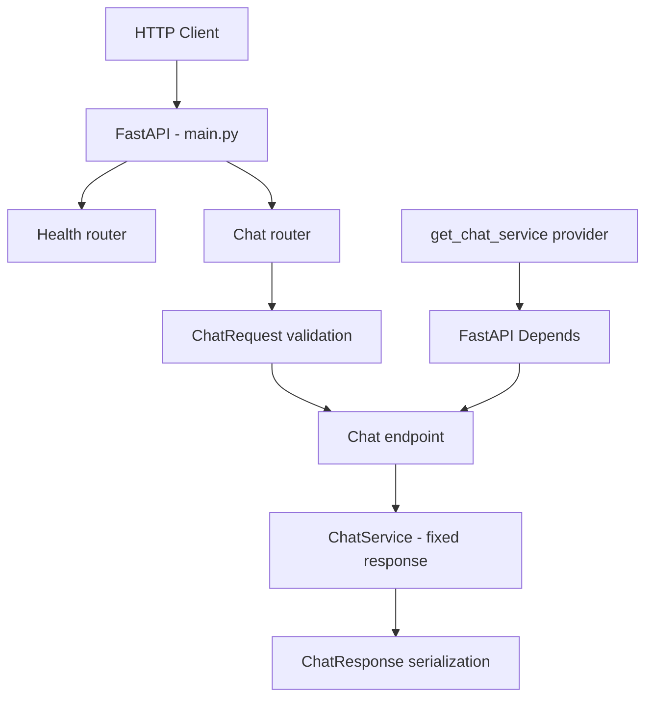
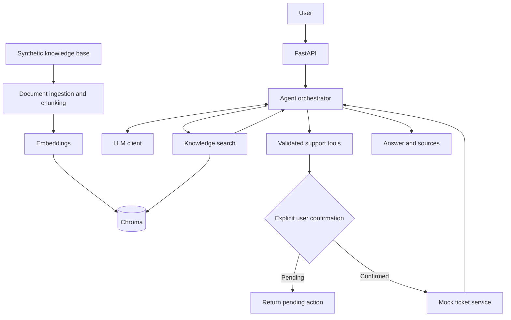

# SupportOps RAG Agent

**AI-Powered Support Assistant with RAG, Tool Calling & FastAPI**

SupportOps RAG Agent is a Python and FastAPI portfolio project exploring how retrieval-augmented generation (RAG) and LLM tool calling can support SaaS customer service workflows.

The goal is to build a reliable, testable, and maintainable assistant that answers questions using a knowledge base, cites its sources, and creates mock support tickets only after explicit user confirmation.

> **Status:** In development  
> **Current stage:** Stage 0 — Setup & Architecture  
> **Latest completed task:** 0.5 — Dependency Injection  
> **Next task:** 0.6 — Asynchronous Python

## Overview

Support teams spend time searching documentation, investigating recurring issues, and creating tickets. The planned assistant will help by:

- Retrieving relevant information from a document knowledge base.
- Generating answers grounded in retrieved documents and providing source references.
- Executing predefined tools through LLM function calling.
- Creating mock support tickets after explicit user confirmation.
- Handling insufficient context, external service failures, and invalid tool arguments.
- Measuring retrieval and answer quality through reproducible evaluation.

The project uses fictional support scenarios and synthetic documentation. The initial implementation deliberately avoids LangChain and LangGraph to make the underlying mechanisms explicit.

## Current Features

- Installable Python package using a `src` layout and `pyproject.toml`.
- FastAPI application with `GET /health` and a typed `POST /chat` stub.
- Pydantic v2 request and response models, whitespace normalization, length constraints, and strict validation of retrieval parameters.
- Swagger UI, ReDoc, and generated OpenAPI specification.
- Reusable TestClient fixture with setup and teardown.
- Parametrized API tests, response contract checks, and Pydantic unit tests, including positive, negative, and boundary cases.
- Separate health and chat routers, registered by the application entry point.
- ChatService with a typed interface and no dependency on FastAPI or HTTP.
- Request-scoped ChatService creation through a FastAPI dependency provider and `Depends`.
- Integration test with a replaceable service and cleanup of dependency overrides.
- **28 automated test cases**, including service and schema unit tests.
- Ruff and mypy development tooling.

The chat endpoint currently returns a fixed response. RAG, LLM integration, and agent tool calling are not yet implemented.

## Tech Stack

| Category | Technologies | Status |
|---|---|---|
| Language | Python 3.12+ | Implemented |
| Backend | FastAPI, Uvicorn | Implemented |
| Data validation | Pydantic v2 | Implemented |
| Testing | pytest, httpx2 | Implemented |
| Code quality | Ruff, mypy | In use |
| LLM integration | OpenAI Responses API | Planned |
| Retrieval | Embeddings, similarity search | Planned |
| Vector database | Chroma | Planned |
| Containerization | Docker | Planned |
| CI/CD | GitHub Actions | Planned |

## Getting Started

### Prerequisites

- Python 3.12 or higher (development tested on Windows with Python 3.13).
- Git and pip.

No API key or external database is required for the current implementation.

### Installation

Clone the active development branch:

```bash
git clone --branch dev https://github.com/JesseJestem/SupportOps-RAG-Agent.git
cd SupportOps-RAG-Agent
python -m venv .venv
```

Activate the virtual environment:

**Windows (PowerShell)**

```powershell
.\.venv\Scripts\Activate.ps1
```

**Linux / macOS**

```bash
source .venv/bin/activate
```

Install the package and development dependencies:

```bash
python -m pip install --upgrade pip
python -m pip install -e ".[dev]"
python -m pip check
```

Editable installation (`-e`) makes changes to Python source files available without reinstalling the package. The `dev` extra includes testing and code quality tools. Dependency versions are not fully locked yet.

### Running the Application

```bash
python -m uvicorn supportops.main:app --reload
```

The `--reload` option is intended for local development only.

| Resource | URL |
|---|---|
| Health check | http://127.0.0.1:8000/health |
| Swagger UI | http://127.0.0.1:8000/docs |
| ReDoc | http://127.0.0.1:8000/redoc |
| OpenAPI schema | http://127.0.0.1:8000/openapi.json |

### Running Tests

From the project root, with the virtual environment activated:

```bash
python -m pytest -v
```

Run individual test modules:

```bash
python -m pytest tests/test_health.py -v
python -m pytest tests/test_chat.py -v
python -m pytest tests/test_chat_service.py -v
```

The current suite covers 8 health/routing cases, 15 chat validation cases, 1 chat response contract case, 2 Pydantic unit tests, 1 ChatService unit test, and 1 dependency override integration test. FastAPI TestClient runs API tests without a separate Uvicorn server or external network requests.

Task 0.5: `28 passed` in a review reproduction on Linux (Python 3.13.5, FastAPI 0.128.2, Pydantic 2.13.5, httpx 0.28.1, pytest 9.0.2). The review used the source layout directly rather than a clean package installation. Final local linting, formatting, type checking, dependency checks, and clean-environment verification remain to be confirmed.

### Code Quality Checks

```bash
python -m pip check
python -m ruff check .
python -m ruff format --check .
python -m mypy src tests
python -m pytest -v
```

To format files automatically:

```bash
python -m ruff format .
```

To apply supported lint fixes, review the resulting diff:

```bash
python -m ruff check . --fix
```

## Project Structure

```text
SupportOps-RAG-Agent/
├── src/
│   └── supportops/
│       ├── __init__.py
│       ├── main.py
│       ├── schemas.py
│       ├── api/
│       │   ├── __init__.py
│       │   ├── chat.py
│       │   ├── dependencies.py
│       │   └── health.py
│       └── services/
│           ├── __init__.py
│           └── chat.py
├── tests/
│   ├── conftest.py
│   ├── test_chat.py
│   ├── test_chat_service.py
│   └── test_health.py
├── .gitignore
├── LICENSE
├── PROGRESS.md
├── README.md
└── pyproject.toml
```

`main.py` creates the FastAPI application and registers routers. `api/` handles HTTP routing, `schemas.py` defines request and response contracts, and `services/` contains application logic. `api/dependencies.py` provides a new ChatService per request through FastAPI `Depends`. Tests can substitute the provider with a stub and remove the override afterward. The service remains independent of HTTP.

## System Architecture

### Current implementation



The integration test replaces `get_chat_service` using `app.dependency_overrides`, verifies that the normalized message reaches a `StubChatService`, and removes the override in a `finally` block. No external LLM client is connected.

### Planned architecture



This diagram is a conceptual target, not a description of the current implementation. Confirmation will be enforced in application logic before ticket creation, rather than delegated to the LLM.

## API Endpoints

| Method | Endpoint | Description | Status |
|---|---|---|---|
| GET | `/health` | Application liveness | Implemented |
| POST | `/chat` | Validate chat requests and return a response | Implemented (stub) |
| POST | `/documents/ingest` | Index knowledge-base documents | Planned |
| POST | `/tickets/confirm` | Confirm a proposed support ticket | Planned |
| GET | `/tickets/{id}` | Retrieve a mock ticket | Planned |

### GET /health

HTTP 200:

```json
{
  "status": "ok"
}
```

This is a basic liveness check. It does not verify the readiness of external services.

### POST /chat

Example request:

```json
{
  "message": "How can I reset my password?",
  "top_k": 5
}
```

| Field | Type | Default | Constraints |
|---|---|---|---|
| `message` | string | Required | 1–2000 characters after trimming leading and trailing whitespace |
| `top_k` | integer | `5` | 1–20 inclusive; strict integer validation (strings, floats, and booleans rejected) |

HTTP 200 (current stub response):

```json
{
  "answer": "Chat is not implemented yet.",
  "sources": []
}
```

Invalid request data returns HTTP 422 using FastAPI's default validation error format. The current implementation does not perform retrieval, call an LLM, or create tickets. The message length limit counts characters, not LLM tokens.

## Development Roadmap

### Stage 0 — Setup & Architecture (In Progress)

- [x] 0.0 — Initial technical assessment.
- [x] 0.1 — Project bootstrap, health endpoint, dependency configuration, and initial checks.
- [x] 0.2 — Testing fundamentals: fixtures, parametrization, positive and negative cases.
- [x] 0.3 — REST & Pydantic: chat API contract, validation, and boundary tests.
- [x] 0.4 — Application architecture: API routers and service layer (refactor merged; final local quality checks pending).
- [x] 0.5 — Dependency injection and dependency overrides for testing (code reviewed; 28 tests passed in review environment).
- [ ] 0.6 — Asynchronous Python and blocking vs non-blocking I/O.
- [ ] 0.7 — Final technical review and clean-environment verification.

### Stage 1 — Document Ingestion

- [ ] Create synthetic Markdown and TXT knowledge-base documents.
- [ ] Load documents and extract metadata.
- [ ] Implement text and token-aware chunking.
- [ ] Generate embeddings and store chunks in Chroma.
- [ ] Add ingestion tests.

### Stage 2 — Basic RAG

- [ ] Implement vector similarity search and top-k retrieval.
- [ ] Construct prompts from retrieved context.
- [ ] Integrate the OpenAI Responses API.
- [ ] Replace the `/chat` stub with the RAG pipeline.
- [ ] Return answers with source references and handle insufficient context.
- [ ] Add retrieval and RAG integration tests.

### Stage 3 — Agent & Tool Calling

- [ ] Implement function calling and an agent execution loop.
- [ ] Add knowledge-base search and mock ticket creation tools.
- [ ] Validate tool arguments and enforce explicit confirmation.
- [ ] Manage action state and prevent duplicate ticket creation.
- [ ] Handle tool failures, timeouts, and retries.

### Stage 4 — Evaluation & Testing

- [ ] Create a reproducible golden dataset.
- [ ] Measure Recall@K and Mean Reciprocal Rank (MRR).
- [ ] Evaluate answer correctness, groundedness, source accuracy, and abstention.
- [ ] Add regression tests and mock external LLM dependencies.
- [ ] Publish reproducible evaluation results.

### Stage 5 — Production Readiness

- [ ] Add environment-based configuration, structured logging, and error handling.
- [ ] Configure timeouts, retries, and security safeguards.
- [ ] Add basic observability.
- [ ] Containerize with Docker and configure GitHub Actions.
- [ ] Verify reproducible deployment and dependency management.

### Stage 6 — Portfolio & Interview

- [ ] Finalize architecture documentation and engineering trade-offs.
- [ ] Publish evaluation results and an end-to-end demo.
- [ ] Document limitations and prepare the first stable release.
- [ ] Prepare an English technical presentation and project walkthrough.

See [PROGRESS.md](PROGRESS.md) for the development history.

## Engineering Principles

- **Modularity:** Separate HTTP handling, application logic, retrieval, LLM integration, and storage as the project grows.
- **Testability:** Use unit and integration tests with controlled external dependencies.
- **Reliability:** Handle errors, timeouts, retries, and invalid responses.
- **Transparency:** Provide supporting sources and abstain when evidence is insufficient.
- **Safety:** Validate tool arguments and require explicit confirmation for side effects.
- **Maintainability:** Use type hints, clear contracts, and automated checks.
- **Reproducibility:** Document setup and evaluation procedures.
- **Simplicity:** Introduce abstractions only when they solve a concrete problem.

## Evaluation Strategy

The following metrics are planned; no RAG evaluation results are available yet.

| Metric | Purpose |
|---|---|
| Recall@K | Measure retrieval of relevant documents |
| MRR | Measure the rank of the first relevant result |
| Answer correctness | Evaluate factual accuracy |
| Groundedness | Evaluate support from retrieved context |
| Source accuracy | Verify source references |
| Abstention accuracy | Evaluate behavior when evidence is insufficient |
| Tool success rate | Measure successful tool execution |
| Response latency | Measure application performance |

## Git Workflow

| Branch | Purpose |
|---|---|
| `main` | Stable releases (intended) |
| `dev` | Active development and integration |
| `feature/*` | New functionality |
| `fix/*` | Bug fixes |
| `refactor/*` | Code restructuring |

The intended workflow uses short-lived branches and pull requests into `dev`. Commits follow the Conventional Commits format:

```text
chore(setup): initialize project
feat(api): implement chat schemas and request validation
test(api): add fixtures and parametrized endpoint tests
refactor(api): separate routing and service logic
refactor(api): introduce dependency injection and overrides
```

## Project Goals

This project is intended to demonstrate end-to-end AI engineering skills: RAG fundamentals, tool calling, Python backend development, automated testing, evaluation, production reliability, and explainable system design decisions.

## Security & Data

- All planned knowledge-base documents and tickets are fictional.
- No real customer data or proprietary employer information is used.
- API keys and credentials must never be committed to Git.
- Future credentials will be supplied through environment variables.
- Actions with side effects will require explicit confirmation and validated arguments.

## Current Limitations

- Chat responses are fixed; no LLM, embeddings, vector database, or RAG pipeline is connected.
- No agent loop, tool execution, or ticket storage.
- ChatService is constructed directly inside the endpoint; replaceable dependency providers are not yet implemented.
- No authentication, authorization, or production security controls yet.
- No production deployment, Docker, or CI/CD pipeline yet.
- Dependency versions are not fully locked; clean-environment installation verification is pending.
- No retrieval or answer-quality evaluation has been performed yet.

## License

This project is licensed under the MIT License. See [LICENSE](LICENSE) for details.
