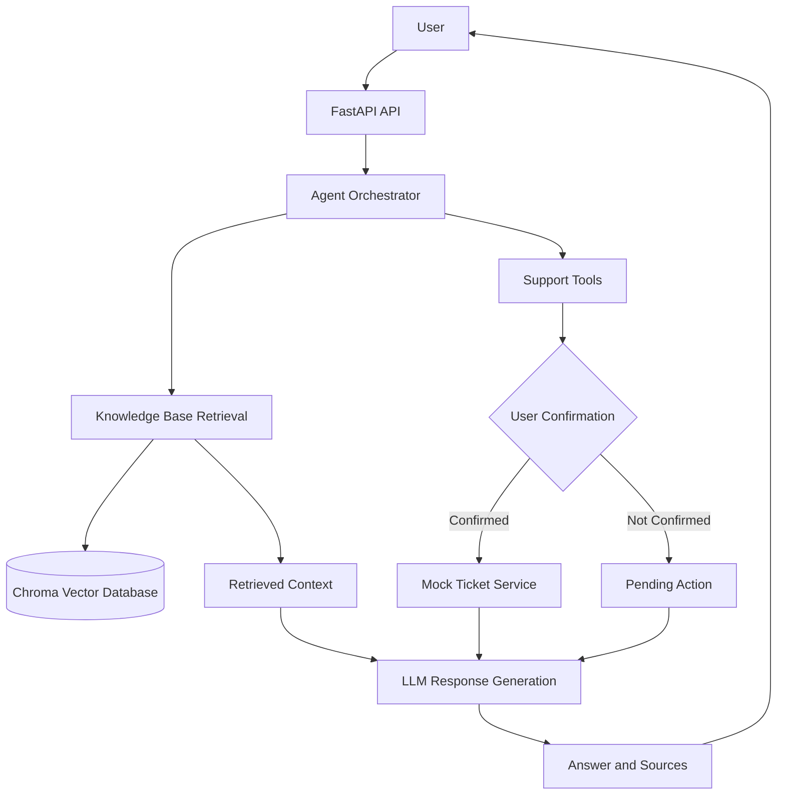

# SupportOps RAG Agent

**AI-Powered Support Assistant with RAG, Tool Calling & FastAPI**

An AI-powered support assistant designed to answer questions using a
knowledge base, retrieve relevant documentation, and automate support
workflows through LLM tool calling.

The project focuses on building a reliable, testable, and maintainable
AI agent using modern software and AI engineering practices.

> **Status:** In development
>
> **Current Stage:** Stage 0 — Setup & Architecture

## Overview

Support teams often spend significant time searching documentation,
investigating recurring issues, and manually creating support tickets.

SupportOps RAG Agent explores how Retrieval-Augmented Generation (RAG)
and AI agents can improve these workflows.

The system is designed to:

- Retrieve relevant information from a document knowledge base.
- Generate answers grounded in retrieved documents.
- Provide references to the information used.
- Execute predefined tools through LLM function calling.
- Create mock support tickets after explicit user confirmation.
- Handle missing information and tool failures safely.
- Measure retrieval and answer quality through automated evaluation.

The project uses fictional support scenarios and synthetic documentation.

## Current Features

The following functionality is currently implemented:

- Python project with a modular `src` layout.
- Dependency management through `pyproject.toml`.
- FastAPI application.
- `GET /health` endpoint.
- Automatic API documentation using Swagger UI and ReDoc.
- Automated API integration test using pytest and FastAPI TestClient.
- Development dependencies for linting, formatting, and static type checking.
- Git repository with development and stable branches.

RAG, vector search, LLM integration, and agent tool calling are planned
but not yet implemented.

## Tech Stack

| Category | Technologies | Status |
|---|---|---|
| Language | Python 3.12+ | Implemented |
| Backend | FastAPI, Uvicorn | Implemented |
| Data Validation | Pydantic | Planned explicit schemas |
| LLM Integration | OpenAI Responses API | Planned |
| Retrieval | Embeddings, similarity search | Planned |
| Vector Database | Chroma | Planned |
| Testing | pytest, httpx | Implemented |
| Code Quality | Ruff, mypy | Configured dependencies |
| Containerization | Docker | Planned |
| CI/CD | GitHub Actions | Planned |

The initial implementation uses a lightweight Python architecture
without LangChain or LangGraph to make the core RAG and agent
mechanisms easier to understand, test, and maintain.

## Getting Started

### Prerequisites

- Python 3.12 or higher
- Git
- pip

No OpenAI API key or external database is required for the current
implementation.

### Installation

Clone the repository:

```bash
git clone --branch dev https://github.com/JesseJestem/SupportOps-RAG-Agent.git
cd SupportOps-RAG-Agent
```

Create a virtual environment:

```bash
python -m venv .venv
```

Activate the virtual environment.

**Windows (PowerShell):**

```powershell
.\.venv\Scripts\Activate.ps1
```

**Linux / macOS:**

```bash
source .venv/bin/activate
```

Upgrade pip:

```bash
python -m pip install --upgrade pip
```

Install the project and development dependencies:

```bash
python -m pip install -e ".[dev]"
```

The `-e` flag installs the project in editable mode, allowing source
code changes to take effect without reinstalling the package.

The `dev` extra includes testing and code quality dependencies.

### Running the Application

From the project root, with the virtual environment activated:

```bash
python -m uvicorn supportops.main:app --reload
```

The API will be available at:

http://127.0.0.1:8000

| Resource | URL |
|---|---|
| Health Check | http://127.0.0.1:8000/health |
| Swagger UI | http://127.0.0.1:8000/docs |
| ReDoc | http://127.0.0.1:8000/redoc |
| OpenAPI Schema | http://127.0.0.1:8000/openapi.json |

To verify that the application is running:

**Windows:**

```powershell
curl.exe -i http://127.0.0.1:8000/health
```

**Linux / macOS:**

```bash
curl -i http://127.0.0.1:8000/health
```

Expected HTTP status:

```text
200 OK
```

Expected response:

```json
{
    "status": "ok"
}
```

The `--reload` option is intended for local development only.

### Running Tests

Run all automated tests from the project root:

```bash
python -m pytest
```

Run tests with detailed output:

```bash
python -m pytest -v
```

Run a specific test file:

```bash
python -m pytest tests/test_health.py -v
```

The current integration test verifies:

- HTTP response status.
- JSON response body.
- Health-check endpoint routing.

Tests use FastAPI TestClient and do not require a running
Uvicorn server.

### Code Quality Checks

Check the code for linting issues:

```bash
python -m ruff check .
```

Check code formatting:

```bash
python -m ruff format --check .
```

Automatically format the code:

```bash
python -m ruff format .
```

Automatically fix supported linting issues:

```bash
python -m ruff check . --fix
```

Run static type checking:

```bash
python -m mypy src
```

Recommended checks before committing:

```bash
python -m ruff check .
python -m ruff format --check .
python -m mypy src
python -m pytest -v
```

## Project Structure

The project follows a `src` layout to separate application code
from tests and project configuration.

```text
SupportOps-RAG-Agent/
├── src/
│   └── supportops/
│       ├── __init__.py
│       └── main.py
│
├── tests/
│   └── test_health.py
│
├── .gitignore
├── pyproject.toml
├── LICENSE
└── README.md
```

Additional modules will be introduced as the project grows.

## System Architecture

The planned architecture separates the API, agent orchestration,
retrieval, LLM integration, and storage layers.



The planned system follows this workflow:

1. **Document Ingestion** — Load and process support documentation.
2. **Indexing** — Split documents into chunks, generate embeddings,
   and store them in a vector database.
3. **Retrieval** — Search for relevant information based on a user's question.
4. **Agent Orchestration** — Decide whether to retrieve information,
   generate an answer, or call a tool.
5. **Tool Execution** — Perform predefined operations with validated inputs.
6. **Response Generation** — Return a structured response with sources.
7. **Evaluation** — Measure quality, reliability, and performance.

## API Endpoints

| Method | Endpoint | Description | Status |
|---|---|---|---|
| GET | `/health` | Service health check | Implemented |
| POST | `/documents/ingest` | Index knowledge-base documents | Planned |
| POST | `/chat` | Process user questions | Planned |
| POST | `/tickets/confirm` | Confirm a proposed support ticket | Planned |
| GET | `/tickets/{id}` | Retrieve a mock ticket | Planned |

### Health Check

```http
GET /health
```

Response:

```json
{
    "status": "ok"
}
```

This endpoint provides a basic application liveness check.

It does not verify the availability of external dependencies,
such as the OpenAI API or a vector database.

## Development Roadmap

### Stage 0 — Setup & Architecture

**Status: In Progress**

- [x] Create GitHub repository.
- [x] Initialize Python project.
- [x] Create project directory structure.
- [x] Set up virtual environment.
- [x] Configure `.gitignore`.
- [x] Configure `pyproject.toml`.
- [x] Install project dependencies.
- [x] Configure FastAPI application.
- [x] Implement `GET /health`.
- [x] Add initial API integration test.
- [x] Document local installation and execution.
- [ ] Verify installation from a clean environment.
- [ ] Add Pydantic request and response schemas.
- [ ] Introduce dependency injection.
- [ ] Verify linting, formatting, and type checking.

### Stage 1 — Document Ingestion

- [ ] Create synthetic knowledge-base documents.
- [ ] Load Markdown and TXT documents.
- [ ] Extract document metadata.
- [ ] Implement text chunking.
- [ ] Implement token-aware chunking.
- [ ] Generate embeddings.
- [ ] Store document chunks in Chroma.
- [ ] Add ingestion tests.

### Stage 2 — Basic RAG

- [ ] Implement vector similarity search.
- [ ] Implement top-k retrieval.
- [ ] Build prompts from retrieved context.
- [ ] Integrate the OpenAI Responses API.
- [ ] Implement the `POST /chat` endpoint.
- [ ] Return answers with source references.
- [ ] Handle insufficient-context scenarios.
- [ ] Add retrieval and RAG integration tests.

### Stage 3 — Agent & Tool Calling

- [ ] Implement function calling.
- [ ] Implement an agent execution loop.
- [ ] Add a knowledge-base search tool.
- [ ] Add a mock ticket creation tool.
- [ ] Validate tool arguments.
- [ ] Implement explicit confirmation for ticket creation.
- [ ] Implement state management.
- [ ] Handle tool errors, timeouts, and retries.
- [ ] Prevent duplicate ticket creation.

### Stage 4 — Evaluation & Testing

- [ ] Create a reproducible golden dataset.
- [ ] Measure retrieval Recall@K.
- [ ] Measure Mean Reciprocal Rank (MRR).
- [ ] Evaluate answer correctness.
- [ ] Evaluate groundedness and source accuracy.
- [ ] Evaluate correct abstention.
- [ ] Add regression tests for agent workflows.
- [ ] Mock external LLM dependencies.
- [ ] Publish reproducible evaluation results.

### Stage 5 — Production Readiness

- [ ] Add environment-based configuration.
- [ ] Implement structured logging.
- [ ] Improve exception handling.
- [ ] Configure request timeouts and retries.
- [ ] Implement security safeguards.
- [ ] Add basic observability.
- [ ] Containerize the application with Docker.
- [ ] Configure GitHub Actions.
- [ ] Verify reproducible deployment.

### Stage 6 — Portfolio & Documentation

- [ ] Finalize system architecture documentation.
- [ ] Document engineering decisions and trade-offs.
- [ ] Publish evaluation results.
- [ ] Create an end-to-end demonstration.
- [ ] Document system limitations.
- [ ] Prepare the first stable release.

## Engineering Principles

The project follows several key engineering principles:

- **Modularity:** Separate API, business logic, retrieval,
  LLM integration, and storage.

- **Testability:** Support unit and integration testing with mocked
  external dependencies.

- **Reliability:** Handle errors, timeouts, retries,
  and invalid tool responses.

- **Transparency:** Provide supporting sources for generated answers.

- **Safety:** Require explicit confirmation before actions
  with side effects.

- **Maintainability:** Use type hints, clear interfaces,
  and automated code quality checks.

- **Reproducibility:** Document dependencies, configuration,
  execution, and evaluation procedures.

- **Simplicity:** Avoid unnecessary frameworks and abstractions.

## Evaluation Strategy

The planned evaluation process will include:

| Metric | Purpose |
|---|---|
| Recall@K | Measure relevant document retrieval |
| MRR | Measure ranking quality |
| Answer Correctness | Evaluate factual accuracy |
| Groundedness | Measure consistency with retrieved context |
| Source Accuracy | Verify supporting references |
| Abstention Accuracy | Evaluate handling of insufficient information |
| Tool Success Rate | Measure successful tool execution |
| Response Latency | Measure system performance |

Evaluation results will be published after implementation and testing.

## Git Workflow

The project uses a simplified branching strategy.

| Branch | Purpose |
|---|---|
| `main` | Stable and verified application versions |
| `dev` | Active development and integration |
| `feature/*` | New functionality |
| `fix/*` | Bug fixes |
| `refactor/*` | Code restructuring |

Commit messages follow the Conventional Commits format:

```text
type(scope): description
```

Examples:

```text
chore(setup): initialize project
feat(api): add health endpoint
test(api): add health endpoint integration test
docs(readme): add installation instructions
fix(retrieval): handle empty search results
```

## Project Goals

This project is being developed as a practical AI engineering
portfolio project.

The main learning and engineering objectives are:

1. Understand and implement RAG architecture.
2. Build LLM-powered agents with tool calling.
3. Develop production-oriented Python APIs.
4. Apply software testing and evaluation techniques to AI systems.
5. Explore reliability, observability, and failure handling.
6. Implement reproducible development and deployment workflows.
7. Demonstrate end-to-end system design and engineering decisions.

## Security & Data

- All sample documents and support tickets are fictional.
- No real customer information is used.
- No proprietary employer data is included.
- API keys and credentials must never be committed to Git.
- Future external service credentials will be supplied through
  environment variables.
- Actions with side effects will require explicit user confirmation.
- Tool arguments will be validated before execution.

## Current Limitations

The project is currently in the initial development stage.

- No LLM integration.
- No document ingestion pipeline.
- No vector database integration.
- No RAG pipeline.
- No agent orchestration or tool execution.
- No authentication or authorization.
- No Docker deployment.
- No automated CI/CD pipeline.

These capabilities will be implemented progressively according
to the development roadmap.

## License

This project is licensed under the MIT License.

See the [LICENSE](LICENSE) file for details.